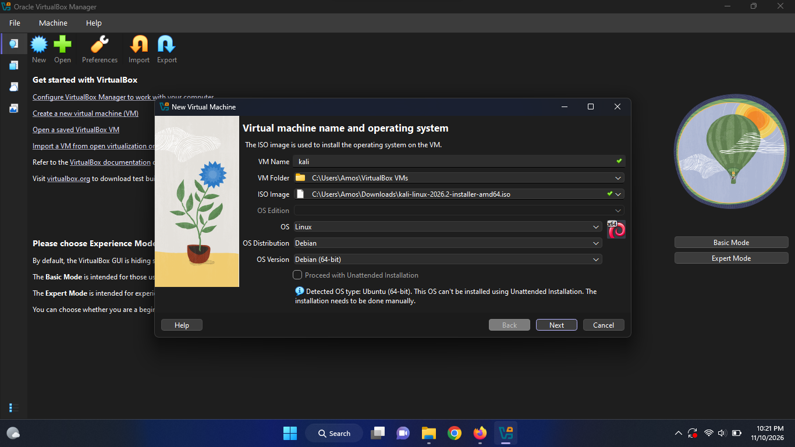
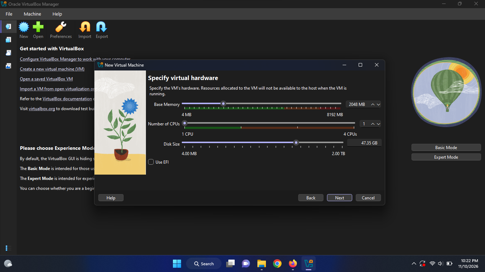
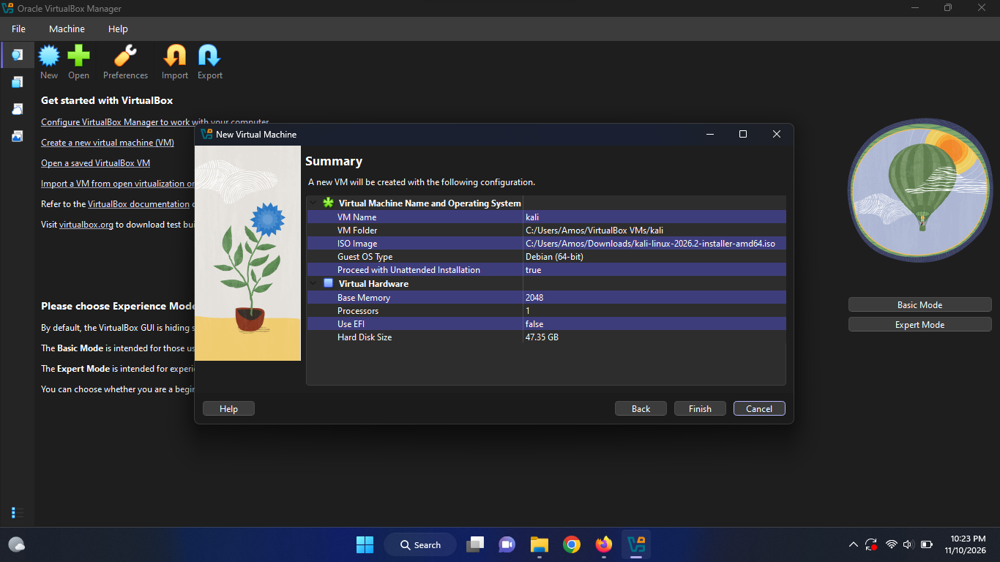
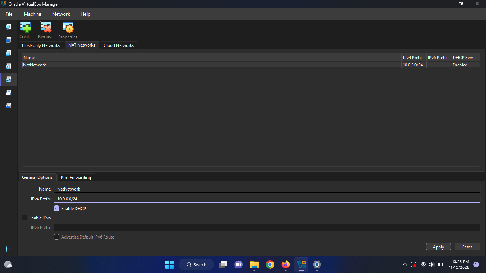
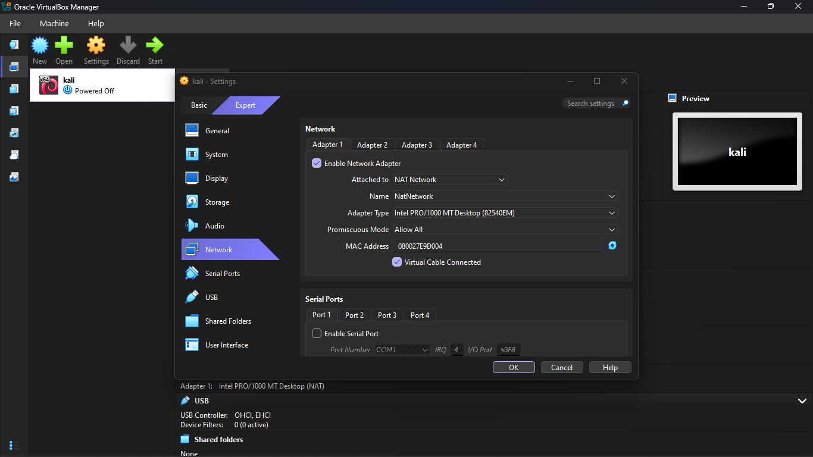
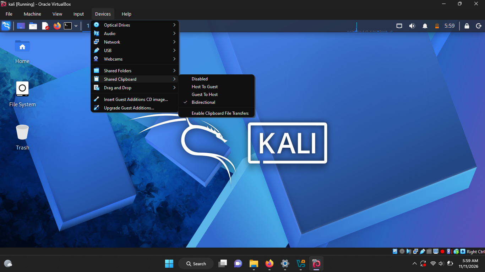
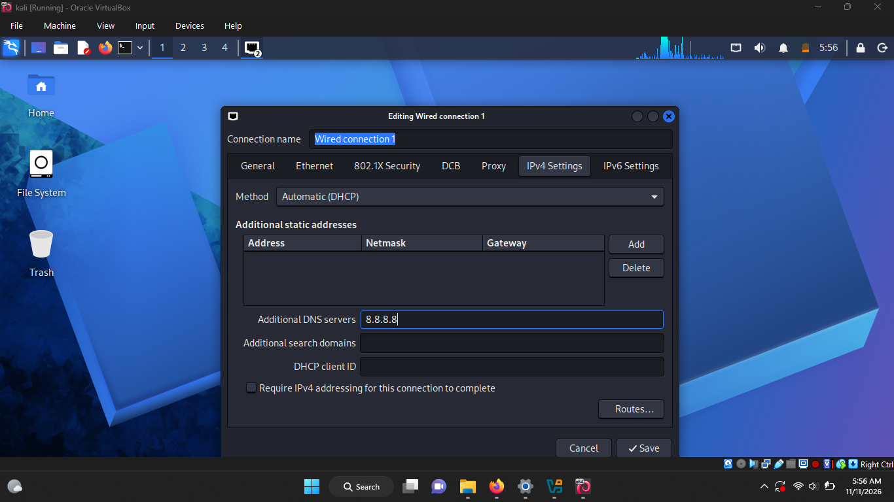
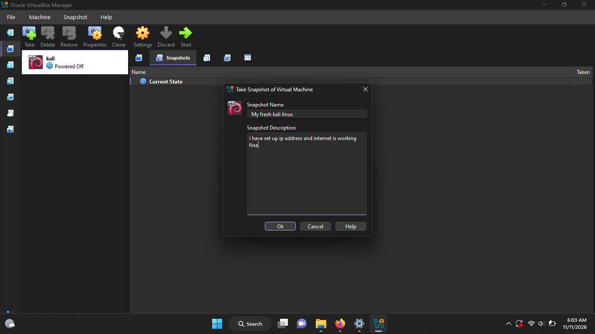

# Cybersecurity Lab Environment Setup

**Project:** Cybersecurity Lab Environment Setup  
**Focus:** Cybersecurity | Network Security  
**Platform:** Windows Host with Kali Linux Virtual Machine  
**Virtualization:** Oracle VirtualBox  
**Author:** Amos Kimunya

---

## 1. Project Overview

This project documents the setup and configuration of a virtual cybersecurity lab using Oracle VirtualBox and Kali Linux.

The purpose of the lab is to establish an isolated and controlled environment for cybersecurity learning, networking experiments, security testing, and practical exercises.

The project covers virtual machine installation, storage configuration, network setup, DNS configuration, connectivity verification, and snapshot management.

## 2. Project Objectives

- Set up a Kali Linux virtual machine using Oracle VirtualBox.
- Configure virtual machine storage and system resources.
- Configure a NAT Network for network connectivity.
- Enable clipboard sharing between the host and virtual machine.
- Configure DNS resolution.
- Verify network connectivity.
- Create a virtual machine snapshot for recovery.

## 3. Lab Architecture

The lab consists of a Windows host operating system running Oracle VirtualBox, with Kali Linux operating as a guest virtual machine.

**Architecture:**

```text
Windows Host Machine
        |
        | Oracle VirtualBox
        |
        v
  Kali Linux VM
        |
        | NAT Network
        |
        v
     Internet
```

## 4. Lab Configuration

| Component | Configuration |
|---|---|
| Host OS | Windows |
| Virtualization | Oracle VirtualBox |
| Guest OS | Kali Linux |
| Network Mode | NAT Network |
| DNS | Configured and tested |
| Snapshot | Created |
| Clipboard Sharing | Enabled |

## 5. Lab Setup Procedure

### Step 1: Virtual Machine Setup

Created and configured the Kali Linux virtual machine in Oracle VirtualBox.



### Step 2: Virtual Machine Storage

Configured the virtual machine's storage to accommodate the Kali Linux operating system.



### Step 3: VM Configuration Summary

Reviewed the virtual machine configuration before starting the environment.



### Step 4: Network Configuration

Configured the virtual machine's network adapter for NAT Network connectivity.



### Step 5: NAT Network Configuration

Configured the NAT Network in VirtualBox to provide network connectivity to the guest system.



### Step 6: Clipboard Sharing

Enabled clipboard sharing to support interaction between the Windows host and Kali Linux guest.



## 6. DNS and Connectivity Verification

Configured DNS resolution and verified that the Kali Linux environment could resolve external domain names.



## 7. Snapshot and Recovery

Created a virtual machine snapshot to preserve the configured lab environment.

This provides a recovery point that can be used to restore the virtual machine to its saved state if future experiments affect the configuration.



## 8. Problems Encountered and Solutions

The lab setup involved configuring the virtual machine, networking, storage, and host-to-guest integration.

Configuration issues were addressed during setup, and the resulting environment was tested to confirm network connectivity.

## 9. What I Learned

Through this project, I gained practical experience in:

- Creating and configuring virtual machines.
- Managing virtual machine storage.
- Understanding VirtualBox network modes.
- Configuring NAT Network connectivity.
- Understanding DNS resolution.
- Enabling host-to-guest clipboard integration.
- Using snapshots for virtual machine recovery.
- Building a controlled environment for cybersecurity practice.

## 10. Security and Ethical Use

This environment is intended for educational purposes, authorized security testing, and controlled cybersecurity experiments.

Any future security testing will be conducted only on systems and networks where permission has been granted.

## 11. Tools and Technologies

- Windows
- Oracle VirtualBox
- Kali Linux
- NAT Network
- DNS
- Linux command-line tools

## 12. Author and Project Information

**Author:** Amos Kimunya 
**Focus:** Cybersecurity | Network Security

**GitHub:** https://github.com/amoskim318

---

*This project forms part of my practical cybersecurity learning and portfolio development.*